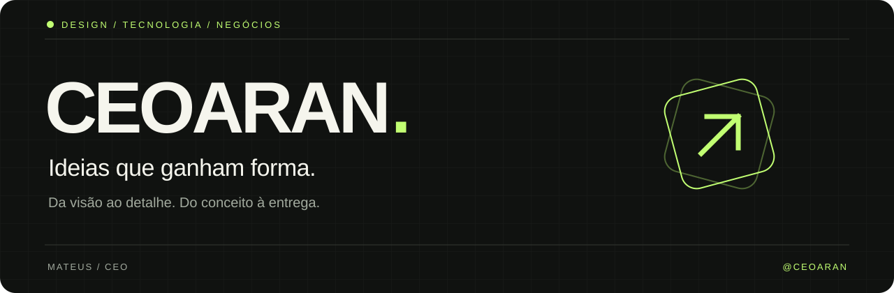

  

  

 

### Ideias. Design. Execução.

Bem-vindo ao **CEOARAN** — meu espaço para reunir projetos e dar forma a novas ideias.

Um ponto de encontro entre criação, tecnologia e visão de negócio.

 

### Da ideia à entrega

| Entender | Dar forma | Refinar |
| :--- | :--- | :--- |
| O problema, o contexto e quem vai usar. | Conteúdo, identidade e funcionalidade trabalhando juntos. | Os detalhes que tornam a experiência mais clara e útil. |

 

### Explore

Os repositórios públicos estão reunidos na [aba de projetos](https://github.com/CEOARAN?tab=repositories).

 

---

  <strong>Uma ideia merece uma boa execução.</strong> 
  CEOARAN · Design, tecnologia e negócios.

